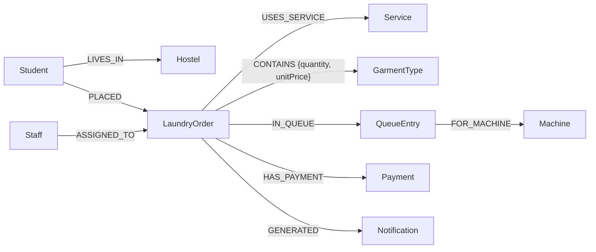

# Design — Graph Data Model

This document defines the property-graph model for the Laundry Management
System. To see how it was derived from the 13 Oracle tables, read
[relational-vs-graph.md](relational-vs-graph.md).

## 1. Modeling approach

The model is **graph-idiomatic, not a copy of the tables**:

- Each **independent entity** becomes a **node** with a label.
- Each **foreign key** becomes a **relationship**. A relationship stores the
  link directly, so no join is needed to follow it.
- A **many-to-many link table with attributes** (`ORDER_ITEM`) becomes a
  **relationship with properties**.
- A **multivalued attribute** (the phone tables) becomes a **list property**.
- Entities that have their own identity, their own attributes and their own
  constraints (`QUEUE_ENTRY`, `PAYMENT`, `NOTIFICATION`) **stay as nodes**.
- Nothing is stored that can be derived by traversal. For example, there is no
  `Student-RECEIVES->Notification` relationship. This mirrors the Oracle BCNF
  decision to leave `StudentID` out of `NOTIFICATION`.

## 2. Model diagram



Notification → Student is a **derived path**, not a stored relationship:
`(s:Student)-[:PLACED]->(:LaundryOrder)-[:GENERATED]->(n:Notification)`.

## 3. Node labels and properties

Property names use camelCase, which is the usual Neo4j convention. IDs keep
the Oracle values (`S001`, `O003`, …).

| Label | Property | Type | Rules (from Oracle) |
|-------|----------|------|---------------------|
| **Hostel** | hostelId | string | unique, required |
| | hostelName | string | unique, required |
| | location | string | required |
| **Student** | studentId | string | unique, required |
| | studentName | string | required |
| | email | string | unique, required |
| | roomNo | string | required |
| | phones | list&lt;string&gt; | no duplicate entries (replaces STUDENT_PHONE) |
| **Staff** | staffId | string | unique, required |
| | staffName | string | required |
| | staffRole | string | required |
| | phones | list&lt;string&gt; | no duplicate entries (replaces STAFF_PHONE) |
| **Service** | serviceId | string | unique, required |
| | serviceName | string | unique, required |
| | pricePerItem | float | required, > 0 |
| | estimatedHours | integer | required, > 0 |
| **GarmentType** | garmentTypeId | string | unique, required |
| | garmentName | string | unique, required |
| | category | string | required |
| **Machine** | machineId | string | unique, required |
| | machineType | string | required |
| | capacity | float | required, > 0 |
| | machineStatus | string | required; one of `Available`, `Running`, `Maintenance`, `Out of Service` |
| **LaundryOrder** | orderId | string | unique, required |
| | orderDateTime | localdatetime | required |
| | expectedCompletion | localdatetime | required, ≥ orderDateTime |
| | actualCompletion | localdatetime | optional (left out when NULL), ≥ orderDateTime |
| | status | string | required; one of `Received`, `Queued`, `Processing`, `Ready for Pickup`, `Picked Up`, `Cancelled` |
| | totalAmount | float | required, ≥ 0 |
| **QueueEntry** | queueId | string | unique, required |
| | queuePosition | integer | required, > 0; unique per machine |
| | addedAt | localdatetime | required |
| | estimatedStart | localdatetime | required |
| **Payment** | paymentId | string | unique, required |
| | amount | float | required, > 0 |
| | paymentDate | date | required |
| | paymentMethod | string | required; one of `UPI`, `Card`, `Cash`, `Net Banking` |
| | paymentStatus | string | required; one of `Paid`, `Pending`, `Failed`, `Refunded` |
| **Notification** | notificationId | string | unique, required |
| | notificationType | string | required |
| | message | string | required |
| | sentAt | localdatetime | required |
| | readStatus | string | required; `Read` or `Unread` |

Neo4j does not store NULL properties. A missing `actualCompletion` simply
means the order is not finished yet, the same as Oracle `NULL`.

**Label name:** we use `LaundryOrder`, not `Order`. It matches the Oracle
table name and avoids confusion with the Cypher keyword `ORDER BY`.

## 4. Relationship types

| Relationship | From → To | Cardinality | Properties | Replaces Oracle |
|--------------|-----------|-------------|------------|-----------------|
| LIVES_IN | Student → Hostel | N:1, each student exactly 1 | — | STUDENT.HostelID FK |
| PLACED | Student → LaundryOrder | 1:N, each order exactly 1 | — | LAUNDRY_ORDER.StudentID FK |
| ASSIGNED_TO | Staff → LaundryOrder | 1:N, each order exactly 1 | — | LAUNDRY_ORDER.StaffID FK |
| USES_SERVICE | LaundryOrder → Service | N:1, each order exactly 1 | — | LAUNDRY_ORDER.ServiceID FK |
| CONTAINS | LaundryOrder → GarmentType | M:N, each order ≥ 1 | quantity (int > 0), unitPrice (float > 0) | ORDER_ITEM table |
| IN_QUEUE | LaundryOrder → QueueEntry | 1:0..1 | — | QUEUE_ENTRY.OrderID FK |
| FOR_MACHINE | QueueEntry → Machine | N:1, each entry exactly 1 | — | QUEUE_ENTRY.MachineID FK |
| HAS_PAYMENT | LaundryOrder → Payment | 1:1 | — | PAYMENT.OrderID FK + UNIQUE |
| GENERATED | LaundryOrder → Notification | 1:N, each notification exactly 1 | — | NOTIFICATION.OrderID FK |

Relationships point in the direction that reads naturally ("Student PLACED
Order"). Cypher can traverse a relationship in either direction, so the
choice of direction does not affect what queries are possible.

## 5. Constraints and indexes (Community Edition)

Neo4j Community supports **uniqueness constraints**. Each one also creates a
backing index. These cover every Oracle PRIMARY KEY and single-column UNIQUE
constraint:

```cypher
CREATE CONSTRAINT hostel_id      IF NOT EXISTS FOR (n:Hostel)       REQUIRE n.hostelId       IS UNIQUE;
CREATE CONSTRAINT hostel_name    IF NOT EXISTS FOR (n:Hostel)       REQUIRE n.hostelName     IS UNIQUE;
CREATE CONSTRAINT student_id     IF NOT EXISTS FOR (n:Student)      REQUIRE n.studentId      IS UNIQUE;
CREATE CONSTRAINT student_email  IF NOT EXISTS FOR (n:Student)      REQUIRE n.email          IS UNIQUE;
CREATE CONSTRAINT staff_id       IF NOT EXISTS FOR (n:Staff)        REQUIRE n.staffId        IS UNIQUE;
CREATE CONSTRAINT service_id     IF NOT EXISTS FOR (n:Service)      REQUIRE n.serviceId      IS UNIQUE;
CREATE CONSTRAINT service_name   IF NOT EXISTS FOR (n:Service)      REQUIRE n.serviceName    IS UNIQUE;
CREATE CONSTRAINT garment_id     IF NOT EXISTS FOR (n:GarmentType)  REQUIRE n.garmentTypeId  IS UNIQUE;
CREATE CONSTRAINT garment_name   IF NOT EXISTS FOR (n:GarmentType)  REQUIRE n.garmentName    IS UNIQUE;
CREATE CONSTRAINT machine_id     IF NOT EXISTS FOR (n:Machine)      REQUIRE n.machineId      IS UNIQUE;
CREATE CONSTRAINT order_id       IF NOT EXISTS FOR (n:LaundryOrder) REQUIRE n.orderId        IS UNIQUE;
CREATE CONSTRAINT queue_id       IF NOT EXISTS FOR (n:QueueEntry)   REQUIRE n.queueId        IS UNIQUE;
CREATE CONSTRAINT payment_id     IF NOT EXISTS FOR (n:Payment)      REQUIRE n.paymentId      IS UNIQUE;
CREATE CONSTRAINT notification_id IF NOT EXISTS FOR (n:Notification) REQUIRE n.notificationId IS UNIQUE;
```

An index on `LaundryOrder.status` supports the "pending orders" queries:

```cypher
CREATE INDEX order_status IF NOT EXISTS FOR (n:LaundryOrder) ON (n.status);
```

### What Community cannot enforce, and how we cover it

| Oracle rule | Why Neo4j cannot enforce it | Our replacement |
|-------------|------------------------------|-----------------|
| NOT NULL | Property existence constraints are Enterprise-only | Validation query V-NN-* |
| CHECK (value ranges, IN lists, date order) | Neo4j has no CHECK constraints at all | Validation queries V-CK-* |
| FK "total participation" (every order has a student, service and staff) | Graphs have no FK concept, and a relationship cannot be made mandatory | Validation queries V-FK-* |
| PAYMENT.OrderID UNIQUE (1:1) | Uniqueness is per node property, not per relationship count | Validation query V-11-payment |
| UNIQUE(MachineID, QueuePosition) | The machine is reached through a relationship, not stored as a property | Validation query V-UQ-queue |
| Composite PK of ORDER_ITEM | Became a relationship; `MERGE` stops duplicate `CONTAINS` relationships between the same pair | Validation query V-UQ-contains |
| Data consistency: totalAmount = Σ quantity × unitPrice | Was not enforced in Oracle either (documented by hand) | Validation query V-DC-total |

The validation suite (`cypher/04_validation.cypher`, run by
`python/validate.py`) follows one rule: **each query returns the violating
rows, and an empty result means pass.** Examples:

```cypher
// V-FK-order-student: every order must have exactly one student
MATCH (o:LaundryOrder)
WHERE COUNT { (:Student)-[:PLACED]->(o) } <> 1
RETURN o.orderId AS violation;

// V-CK-order-status
MATCH (o:LaundryOrder)
WHERE NOT o.status IN ['Received','Queued','Processing','Ready for Pickup','Picked Up','Cancelled']
RETURN o.orderId, o.status;

// V-UQ-queue: queue position unique per machine
MATCH (q:QueueEntry)-[:FOR_MACHINE]->(m:Machine)
WITH m, q.queuePosition AS pos, count(*) AS c
WHERE c > 1
RETURN m.machineId, pos, c;
```

## 6. Design decisions

| # | Decision | Alternatives considered | Reason |
|---|----------|------------------------|--------|
| D1 | ORDER_ITEM → `CONTAINS` relationship with properties | `:OrderItem` node | ORDER_ITEM is a weak entity whose only identity is the (Order, GarmentType) pair. That is exactly what a relationship is. It is the textbook graph example of a link table. |
| D2 | Phone tables → `phones` list property | `:Phone` nodes with a `HAS_PHONE` relationship | Phones have no attributes of their own and nothing else links to them. Separate nodes would only add clutter. Trade-off: phone numbers cannot be made globally unique by a constraint (they were not unique in Oracle either). |
| D3 | QUEUE_ENTRY stays a node | `QUEUED_ON` relationship from Order to Machine, with properties | It has its own ID and timestamps, and it is described as a historical record. Keeping it a node keeps `queueId` unique by constraint. |
| D4 | PAYMENT stays a node | Payment properties on LaundryOrder | It has its own ID, method and status. A future design might allow several payments (for example partial or refunded), and a node makes that easy. It also mirrors the Oracle entity. |
| D5 | NOTIFICATION stays a node; no stored Student link | `RECEIVES` relationship to Student | A stored link would duplicate a fact that can be derived (the Oracle BCNF fix). Traversal gives the student in one hop through the order. |
| D6 | Label `LaundryOrder` | `Order` | Matches the Oracle table name and avoids confusion with `ORDER BY` |
| D7 | `localdatetime` for timestamps | `datetime` with a time zone | Oracle used `TIMESTAMP` without a time zone. Keeps values identical. |
| D8 | Load with `MERGE` keyed on IDs | `CREATE` after wiping the database | Re-runnable (GR-3) |
| D9 | No APOC | APOC procedures | Keeps the Docker setup plain and the Cypher portable |
| D10 | PL/SQL → Python driver scripts | APOC custom procedures; Cypher only | Python shows the same concepts (variables, IF, loops, iterating a result like a cursor) in a way that is easy to explain |

## 7. Planned code layout

```
cypher/
  00_reset.cypher            MATCH (n) DETACH DELETE n
  01_constraints.cypher      constraints + indexes (section 5)
  02_load_data.cypher        MERGE nodes, then relationships
  03_queries.cypher          5 ported SQL queries
  04_validation.cypher       V-* integrity checks
  05_workflow.cypher         status transitions + notification creation (GR-5)
  06_showcase.cypher         graph-only queries (GR-6)
python/
  requirements.txt           neo4j, python-dotenv
  db.py                      driver/session helper reading .env
  plsql_q1_highest_order.py  ... plsql_q5_ready_check.py
  run_plsql_equivalents.py   runs all 5
  validate.py                runs 04_validation, prints PASS/FAIL per check
  workflow.py                advance order status / mark ready + notify
scripts/
  load.sh  validate.sh  reset.sh
docker-compose.yml
.env.example
```
